# RAG-Based Student Education Opportunity and Scholarship Eligibility Intelligence System

[](https://www.python.org/)
[](https://fastapi.tiangolo.com/)
[](https://www.postgresql.org/)
[](https://github.com/pgvector/pgvector)
[](https://nextjs.org/)
[](https://react.dev/)
[](https://www.typescriptlang.org/)
[](https://ollama.com/)

> **Academic Final Year Project** · Retrieval-Augmented Generation (RAG) · Deterministic Eligibility Rules · Hybrid Dense & Sparse Retrieval · Full Document Provenance

---

## Table of Contents

- [1. Project Overview](#1-project-overview)
- [2. Problem Statement](#2-problem-statement)
- [3. Project Objectives](#3-project-objectives)
- [4. Key Features](#4-key-features)
- [5. System Architecture](#5-system-architecture)
  - [Architectural Data Flow](#architectural-data-flow)
  - [System Architecture Diagram](#system-architecture-diagram)
  - [Storage Segregation](#storage-segregation)
- [6. Technology Stack](#6-technology-stack)
- [7. Project Directory Structure](#7-project-directory-structure)
- [8. Prerequisites](#8-prerequisites)
- [9. Installation and Setup](#9-installation-and-setup)
  - [Step 1: Clone Repository & Virtual Environment](#step-1-clone-repository--virtual-environment)
  - [Step 2: Install Backend Dependencies](#step-2-install-backend-dependencies)
  - [Step 3: Configure Environment Variables](#step-3-configure-environment-variables)
  - [Step 4: Launch PostgreSQL with pgvector (Docker)](#step-4-launch-postgresql-with-pgvector-docker)
  - [Step 5: Apply Database Migrations](#step-5-apply-database-migrations)
  - [Step 6: Verify Database & Corpus](#step-6-verify-database--corpus)
  - [Step 7: Launch Ollama with Llama 3.2](#step-7-launch-ollama-with-llama-32)
  - [Step 8: Start FastAPI Backend Server](#step-8-start-fastapi-backend-server)
  - [Step 9: Launch Next.js Frontend](#step-9-launch-nextjs-frontend)
- [10. Environment Variables & Configuration](#10-environment-variables--configuration)
- [11. Database & Official Data Sources](#11-database--official-data-sources)
  - [Official Source Governance](#official-source-governance)
  - [Corpus Statistics & Lineage](#corpus-statistics--lineage)
  - [Document Provenance & Metadata](#document-provenance--metadata)
- [12. Application Usage & Interfaces](#12-application-usage--interfaces)
  - [1. Dashboard (`/`)](#1-dashboard-)
  - [2. Student Profile (`/profile`)](#2-student-profile-profile)
  - [3. Opportunities Explorer (`/opportunities`)](#3-opportunities-explorer-opportunities)
  - [4. Recommendations Engine (`/recommendations`)](#4-recommendations-engine-recommendations)
  - [5. AI Assistant & RAG Chatbot (`/chat`)](#5-ai-assistant--rag-chatbot-chat)
  - [6. Source Document Lineage (`/sources`)](#6-source-document-lineage-sources)
- [13. Eligibility Engine & RAG Retrieval Workflow](#13-eligibility-engine--rag-retrieval-workflow)
  - [Strict Separation: Deterministic Evaluation vs. LLM Generation](#strict-separation-deterministic-evaluation-vs-llm-generation)
  - [Deterministic Rule Evaluators](#deterministic-rule-evaluators)
  - [Scoring and Multi-Tier Ranking](#scoring-and-multi-tier-ranking)
  - [Hybrid Retrieval (RRF) & Guardrailed RAG Synthesis](#hybrid-retrieval-rrf--guardrailed-rag-synthesis)
- [14. API Documentation](#14-api-documentation)
- [15. Testing and Validation](#15-testing-and-validation)
- [16. Known Limitations](#16-known-limitations)
- [17. Troubleshooting](#17-troubleshooting)
- [18. Security, Privacy & Data Handling](#18-security-privacy--data-handling)
- [19. Future Enhancements](#19-future-enhancements)
- [20. Authors, Acknowledgements & License](#20-authors-acknowledgements--license)

---

## 1. Project Overview

The **RAG-Based Student Education Opportunity and Scholarship Eligibility Intelligence System** is an end-to-end intelligent platform engineered to assist Indian higher-education students in discovering, evaluating, and applying for government scholarships, fellowships, and academic grants.

Traditional discovery methods require students to manually interpret lengthy official PDFs (ranging from 10 to 60+ pages) with convoluted conditions across disparate ministry portals. Furthermore, conventional conversational AI systems frequently hallucinate non-existent eligibility criteria, outdated deadlines, or inaccurate monetary amounts.

This system addresses these deficiencies through a **tripartite architecture**:
1. **Deterministic Rule Engine:** Executes strict, zero-hallucination rule validation across academic qualifications, annual family income ceilings, affirmative action categories, gender requirements, and state domiciles.
2. **Hybrid Information Retrieval:** Leverages dense vector embeddings (`BAAI/bge-small-en-v1.5` via PostgreSQL `pgvector`) combined with sparse lexical matching (`rank_bm25.BM25Okapi`), fused using Reciprocal Rank Fusion (RRF).
3. **Grounded Retrieval-Augmented Generation (RAG):** Synthesizes natural-language answers strictly from ingested official PDF passages using a locally hosted **Llama 3.2** model via **Ollama**, complete with page-level citations and direct official portal links.

> **Current Operational State:** The project operates in **Local Demo Mode**, wherein student profiles are securely managed on the client side via browser `localStorage` and synchronized to a temporary in-memory backend adapter, leaving the official scholarship corpus and vector database fully persistent and isolated.

---

## 2. Problem Statement

Every academic year, thousands of eligible students across India miss critical scholarship deadlines or fail to apply due to several structural obstacles:

- **Fragmented Information:** Official notices and schemes are distributed across numerous national and statutory portals (e.g., National Scholarship Portal, UGC, AICTE, and individual central ministries).
- **Complex and Dense Guidelines:** Eligibility criteria, mandatory supporting documents, renewal clauses, and reservation categories are buried in multi-page bureaucratic PDF circulars.
- **Ambiguous Self-Evaluation:** Students often cannot ascertain whether their specific combination of course, percentage/CGPA, caste category, and family income qualifies them for a scheme.
- **LLM Hallucination Risk:** Generative AI solutions used without structured constraints frequently invent scholarship amounts, alter deadlines, or formulate incorrect criteria.

### The System's Solution
The system decouples **evaluation** from **explanation**:
- **Deterministic Code Evaluates:** Hard coded rules check numbers and categories against database criteria. If a student earns ₹3,50,000 and the ceiling is ₹2,50,000, the student is marked `NOT_ELIGIBLE` with mathematical certainty.
- **The LLM Explains:** The language model is provided with the retrieved text excerpts and the deterministic evaluation result, prompting it to explain the decision, clarify application steps, and quote verbatim guidelines without inventing facts.

---

## 3. Project Objectives

### Implemented Objectives
- [x] **Centralized Official Opportunity Corpus:** Ingested and indexed 24 official guideline PDFs from strictly approved government bodies (NSP, GoI Ministries, UGC, AICTE).
- [x] **Deterministic Eligibility Engine:** Built three independent rule evaluators (`AcademicRule`, `FinancialRule`, `DemographicRule`) providing structured statuses (`ELIGIBLE`, `NOT_ELIGIBLE`, `INSUFFICIENT_INFORMATION`).
- [x] **Missing Information Detection:** Identifies unpopulated student profile fields and alerts students to missing data rather than failing silently.
- [x] **Transparent Opportunity Ranking:** Multi-component scoring factoring in deadline urgency, financial need, merit surplus, and demographic alignment.
- [x] **Hybrid Document Retrieval:** Parallel dense vector retrieval (pgvector cosine distance) and sparse BM25 vocabulary search with Reciprocal Rank Fusion (RRF).
- [x] **Grounded Local LLM Synthesis:** Integrated Ollama with Llama 3.2 with strict system-level prompt constraints to eliminate hallucinations.
- [x] **Fine-Grained Provenance Attribution:** Every generated answer references source document titles, page numbers, and verified official URLs.
- [x] **Modern Web Application:** Interactive Next.js 16 (React 19, TypeScript) responsive interface with Dashboard, Profile Management, Recommendations, Chatbot, and Source Browser.
- [x] **Privacy-First Local Demo Mode:** Client-side storage of student profiles in browser `localStorage` with an ephemeral backend RAM adapter.

### Future Objectives (Planned)
- [ ] **Durable Authenticated User Profiles:** Secure database accounts with encrypted storage for student personal data.
- [ ] **Automated Optical Character Recognition (OCR):** Pipeline to process scanned, image-only circulars and notifications.
- [ ] **Automated Web Scrapers / Sync Workers:** Scheduled spiders to detect new circulars and update database records automatically.
- [ ] **Automated RAG Evaluation Benchmarks:** Integration of RAGAS or TruLens for automated faithfulness and context-recall metrics.
- [ ] **Multilingual Support:** Localization into Hindi and regional Indian languages.

---

## 4. Key Features

| Category | Feature | Implementation Detail |
| :--- | :--- | :--- |
| **Profile** | Client-Side Demo Mode | Persists student data in browser `localStorage` under `scholarai_student_profile`; syncs to backend RAM adapter via `/api/v1/students/demo`. |
| **Eligibility** | Deterministic Evaluation | Evaluates academic thresholds, family income ceilings, category/caste quotas, gender, and state domiciles without LLM intervention. |
| **Eligibility** | Structured Status Codes | Categorizes student standing into `ELIGIBLE`, `NOT_ELIGIBLE`, and `INSUFFICIENT_INFORMATION` (schema ready for `POTENTIALLY_ELIGIBLE`). |
| **Ranking** | Explainable Scoring | 100-point multi-factor model: Deadline Urgency (max 25), Financial Need (max 20), Academic Merit (max 25), Demographic Target (max 30). |
| **Ingestion** | PDF Processing Pipeline | PyPDFLoader text extraction $\rightarrow$ Regex cleaner $\rightarrow$ RecursiveCharacterTextSplitter (chunk size: 1000, overlap: 200). |
| **Embeddings** | Local Dense Vectors | 384-dimensional dense vectors generated locally on CPU using `BAAI/bge-small-en-v1.5` (`sentence-transformers`). |
| **Vector DB** | PostgreSQL pgvector | Vector column with cosine distance operator (`<=>`) inside standard relational schema. |
| **Lexical Search**| In-Memory BM25 | `rank_bm25.BM25Okapi` tokenizer across all active document chunks with thread-safe refresh capabilities. |
| **Retrieval** | Hybrid Fusion (RRF) | Fuses pgvector and BM25 search ranks using Reciprocal Rank Fusion formula ($k=60$). |
| **Generation** | Local Ollama Llama 3.2 | Completely offline inference via `ChatOllama` at temperature 0.0 with 12 strict negative prompt constraints. |
| **Attribution**| Exact Document Citations | Maps output tokens back to `DocumentChunk` IDs, source document title, page number, and official application URL. |
| **UI** | Interactive Dashboard | Real-time backend health indicators, quick statistics, upcoming deadline alerts, and top ranked opportunities. |
| **UI** | AI Assistant Chatbot | Real-time intent detection routing ("Am I eligible?") to the deterministic engine before grounding responses in RAG context. |
| **System** | Automated Health Checks | `GET /api/v1/health` verifying API uptime, PostgreSQL connection, vector store availability, and active models. |

---

## 5. System Architecture

### Architectural Data Flow

```
Official PDF Guidelines (NSP / GoI / UGC / AICTE)
                     │
                     ▼
       Document Ingestion Pipeline
  [PyPDFLoader ➔ TextCleaner ➔ DocumentChunker]
                     │
         ┌───────────┴───────────┐
         ▼                       ▼
384-dim BGE Embeddings     In-Memory BM25
 (sentence-transformers)     (rank_bm25)
         │                       │
         ▼                       │
PostgreSQL 16 + pgvector         │
(document_chunks.embedding)      │
         │                       │
         └───────────┬───────────┘
                     │
                     ▼
    Student Query / Evaluation Request
                     │
         ┌───────────┴───────────┐
         ▼                       ▼
Deterministic Engine      Hybrid Searcher
[Academic, Financial,     [pgvector <=> Dense]
 Demographic Rules]      [BM25 Sparse Match]
         │                       │
         │             Reciprocal Rank Fusion (RRF)
         │                       │
         └───────────┬───────────┘
                     │
                     ▼
    Prompt Assembly & Guardrail Injection
                     │
                     ▼
      Local Ollama (Llama 3.2 3B)
      [Deterministic Grounding (T=0.0)]
                     │
                     ▼
    FastAPI Endpoints (/api/v1/...)
                     │
                     ▼
     Next.js 16 Web Application
[Dashboard | Profile | Opportunities | Recommendations | Chat | Sources]
```

### System Architecture Diagram

```mermaid
graph TD
    subgraph Frontend["Frontend Layer (Next.js 16 / React 19)"]
        UI_Dash["Dashboard (/)"]
        UI_Prof["Student Profile (/profile)"]
        UI_Opp["Opportunities (/opportunities)"]
        UI_Rec["Recommendations (/recommendations)"]
        UI_Chat["AI Assistant Chatbot (/chat)"]
        UI_Src["Sources Provenance (/sources)"]
        LocalStore[("Browser localStorage")]
        UI_Prof <--> LocalStore
    end

    subgraph Backend["Backend Layer (FastAPI 0.141)"]
        API_Route["FastAPI API Router (/api/v1)"]
        HealthSvc["Health Service (/health)"]
        RAM_Adapt["Demo RAM Adapter (TEMP_STUDENT_PROFILES)"]

        subgraph Logic["Intelligence & Business Logic"]
            EligEng["Deterministic Eligibility Engine\n(AcademicRule, FinancialRule, DemographicRule)"]
            RecEng["Recommendation Engine\n(Multi-Factor Scoring & Ranking)"]
            RAGEng["RAG Core Engine\n(Prompt Assembly & Guardrails)"]
            HybridRet["Hybrid Searcher\n(Reciprocal Rank Fusion - RRF)"]
        end

        subgraph Ingestion["Ingestion Subsystem"]
            PDFLoad["PyPDFLoader"]
            CleanText["TextCleaner"]
            Chunker["DocumentChunker (1000/200)"]
            Embedder["LocalEmbedder (BGE-small-en-v1.5)"]
        end
    end

    subgraph Storage["Persistence & Indexing Layer"]
        subgraph Postgres["PostgreSQL 16 Database (Docker: rag_postgres)"]
            TB_Docs[("source_documents\n(24 Records)")]
            TB_Opps[("opportunities\n(Structured Schemes)")]
            TB_Chunks[("document_chunks\n(884 Chunks)")]
            TB_Vector[("pgvector Extension\n(384-dim Embeddings)")]
            TB_Logs[("eligibility_check_logs")]
        end
        BM25_Idx[("In-Memory BM25 Index\n(rank_bm25.BM25Okapi)")]
    end

    subgraph LLM["Local Inference Engine"]
        Ollama["Ollama Service (Port 11434)"]
        Llama["Llama 3.2 (3B Parameters)"]
        Ollama --> Llama
    end

    %% Frontend to Backend
    UI_Dash --> API_Route
    UI_Prof --> API_Route
    UI_Opp --> API_Route
    UI_Rec --> API_Route
    UI_Chat --> API_Route
    UI_Src --> API_Route

    %% Backend Routing
    API_Route --> HealthSvc
    API_Route --> RAM_Adapt
    API_Route --> EligEng
    API_Route --> RecEng
    API_Route --> RAGEng

    %% Intelligence Flows
    RAM_Adapt --> EligEng
    RAM_Adapt --> RecEng
    EligEng --> TB_Opps
    EligEng --> TB_Logs
    RecEng --> EligEng
    RecEng --> TB_Opps
    RAGEng --> HybridRet
    HybridRet --> TB_Vector
    HybridRet --> BM25_Idx
    RAGEng --> Ollama

    %% Ingestion Flow
    PDFLoad --> CleanText --> Chunker --> Embedder
    Chunker --> TB_Chunks
    Embedder --> TB_Vector
    Chunker --> BM25_Idx
    TB_Docs --> TB_Chunks
```



### Storage Segregation
- **PostgreSQL 16 Relational Tables:** Stores structured business entities (`opportunities`, `source_documents`, `students`, `eligibility_check_logs`).
- **PostgreSQL pgvector Column:** The `embedding` column on the `document_chunks` table holds 384-dimensional dense float vectors indexed for cosine distance searching (`<=>`).
- **In-Memory BM25 Index:** Tokenized sparse vocabulary index maintained in application RAM using `rank_bm25` for fast lexical lookup.
- **Browser LocalStorage:** Contains the student profile during Local Demo Mode; no student personal identity is written to the database disk.

---

## 6. Technology Stack

| Component / Layer | Technology | Version | Purpose in Project |
| :--- | :--- | :--- | :--- |
| **Backend Framework** | FastAPI | `0.141.1` | Asynchronous REST API exposing CRUD, search, eligibility, and RAG routes. |
| **ASGI Server** | Uvicorn | `0.52.4` | High-performance ASGI web server hosting the FastAPI application. |
| **Data Validation** | Pydantic / Pydantic Settings | `2.13.5` / `2.15.0` | Strict schema validation, request/response models, and environment loading. |
| **Database Server** | PostgreSQL | `16` | Primary relational database running in a Docker container (`rag_postgres`). |
| **Vector Extension** | pgvector | `0.2.5` | Native vector similarity search (cosine distance) within PostgreSQL. |
| **Database ORM** | SQLAlchemy | `2.0.52` | Python Object-Relational Mapping for relational and vector models. |
| **DB Driver** | psycopg2-binary | `2.9.12` | PostgreSQL database adapter for Python. |
| **DB Migrations** | Alembic | `1.14.1` | Database schema migrations and version management (`backend/migrations`). |
| **AI Orchestration** | LangChain Core / Community | `>=0.2.0` | Orchestrating prompts, document loading, text splitting, and chat model interfaces. |
| **Embeddings Model** | BAAI/bge-small-en-v1.5 | Local Weights | 384-dimensional dense sentence transformer run locally on CPU. |
| **Embeddings Library**| sentence-transformers / Torch| `6.0.1` / `2.14.0` | Machine learning framework executing local embedding inference. |
| **Lexical Search** | rank_bm25 | `0.2.2` | In-memory Okapi BM25 index for sparse keyword matching. |
| **PDF Ingestion** | pypdf | `6.16.2` | Extraction of raw text and page coordinates from official PDF circulars. |
| **LLM Inference** | Ollama / Llama 3.2 | `llama3.2` (3B) | Local LLM server running quantized Llama 3.2 for grounded generation. |
| **Testing Suite** | pytest / pytest-asyncio | `8.3.5` / `0.24.0` | Automated unit, integration, and API testing (53 verified test cases). |
| **HTTP Client** | HTTPX | `0.28.1` | Testing client for FastAPI integration test execution. |
| **Frontend Framework**| Next.js (App Router) | `16.3.4` | Server-rendered and client-hydrated React web application with Turbopack. |
| **UI Library** | React / React DOM | `19.2.8` | Component-based UI library. |
| **Language** | TypeScript | `^5.0.0` | Type-safe frontend client development. |
| **CSS Framework** | Tailwind CSS / PostCSS | `^4.0.0` | Utility CSS classes complementing custom dark glassmorphic design system. |
| **Icons & Motion** | lucide-react / framer-motion | `1.41.0` / `13.2.0` | Production iconography and micro-animations. |
| **Containerization** | Docker & Docker Compose | Compose v2 | Reproducible container execution for PostgreSQL 16 + pgvector. |

---

## 7. Project Directory Structure

```
RAG/
├── .env                              # Active local environment configuration (git-ignored)
├── .env.example                      # Sanitized configuration template
├── .gitignore                        # Git exclusion rules
├── docker-compose.yml                # Docker definition for PostgreSQL 16 + pgvector
├── main.py                           # Root-level entry point helper
├── requirements.txt                  # Complete pinned Python dependencies
├── README.md                         # Final comprehensive project documentation
│
├── backend/                          # FastAPI Backend Application
│   ├── alembic.ini                   # Alembic database migration config
│   ├── pytest.ini                    # Pytest discovery and warning configuration
│   ├── app/                          # Core application package
│   │   ├── main.py                   # FastAPI app factory, CORS, exception handlers
│   │   ├── api/                      # API routing layer
│   │   │   ├── deps.py               # Dependency injection (get_db, pagination)
│   │   │   └── v1/                   # API v1 routes
│   │   │       ├── router.py         # Aggregated v1 APIRouter
│   │   │       ├── health.py         # System health check endpoint
│   │   │       ├── students.py       # Student CRUD & demo RAM adapter
│   │   │       ├── opportunities.py  # Opportunity catalog CRUD & filtering
│   │   │       ├── documents.py      # Document upload & ingestion pipeline
│   │   │       ├── search.py         # Semantic, keyword, and hybrid search
│   │   │       ├── eligibility.py    # Deterministic eligibility evaluation
│   │   │       ├── recommendations.py# Opportunity scoring and ranking
│   │   │       └── rag.py            # Grounded Q&A endpoint
│   │   ├── core/                     # Application core utilities
│   │   │   ├── config.py             # Pydantic Settings configuration loader
│   │   │   ├── demo.py               # TEMP_STUDENT_PROFILES RAM adapter
│   │   │   └── llm.py                # LLM factory (Ollama ChatOllama / Mock)
│   │   ├── db/                       # Database session & base definitions
│   │   │   ├── base.py               # SQLAlchemy declarative Base & mixins
│   │   │   └── session.py            # Engine and sessionmaker factory
│   │   ├── eligibility/              # Deterministic rule engine
│   │   │   ├── engine.py             # EligibilityEngine orchestrator
│   │   │   └── rules/                # Rule implementations
│   │   │       └── __init__.py       # AcademicRule, FinancialRule, DemographicRule
│   │   ├── ingestion/                # Document processing pipeline
│   │   │   ├── chunker.py            # DocumentChunker (RecursiveCharacterTextSplitter)
│   │   │   ├── cleaner.py            # TextCleaner regex normalization
│   │   │   └── loader.py             # DocumentLoader (PyPDFLoader)
│   │   ├── models/                   # SQLAlchemy ORM models
│   │   │   ├── document.py           # SourceDocument and DocumentChunk (Vector)
│   │   │   ├── eligibility_check_log.py # Audit trail of eligibility decisions
│   │   │   ├── opportunity.py        # Opportunity structured scheme table
│   │   │   └── student.py            # Student profile database table
│   │   ├── rag/                      # Grounded RAG synthesis
│   │   │   └── engine.py             # RAGEngine prompt construction & execution
│   │   ├── recommendations/          # Ranking & scoring engine
│   │   │   ├── engine.py             # RecommendationEngine sorting pipeline
│   │   │   └── scorer.py             # Deadline, Need, Merit, and Demographic scorers
│   │   ├── retrieval/                # Multi-modal retrieval
│   │   │   ├── embedder.py           # LocalEmbedder (BGE-small-en-v1.5 singleton)
│   │   │   ├── hybrid_search.py      # HybridSearcher (Reciprocal Rank Fusion)
│   │   │   ├── keyword_search.py     # KeywordSearcher (rank_bm25.BM25Okapi)
│   │   │   └── search.py             # SemanticSearcher (pgvector cosine distance)
│   │   └── schemas/                  # Pydantic request and response schemas
│   │       ├── document.py
│   │       ├── eligibility.py
│   │       ├── opportunity.py
│   │       ├── rag.py
│   │       ├── recommendations.py
│   │       └── student.py
│   ├── migrations/                   # Alembic migration scripts
│   │   └── versions/
│   │       ├── 001_initial_schema.py
│   │       ├── 002_add_pgvector.py
│   │       └── 003_add_provenance_fields.py
│   └── tests/                        # Automated backend test suite
│       ├── conftest.py               # Shared test fixtures & database rollback
│       ├── unit/                     # Unit test suite
│       │   ├── test_config.py        # 10 configuration tests
│       │   └── test_db_models.py     # 4 database model integrity tests
│       └── integration/              # Integration test suite
│           ├── test_health_api.py    # 8 health endpoint tests
│           ├── test_student_api.py   # 5 student endpoint tests
│           ├── test_opportunity_api.py# 5 opportunity endpoint tests
│           ├── test_document_api.py  # 4 document pipeline tests
│           ├── test_semantic_search.py# 3 pgvector search tests
│           ├── test_hybrid_search.py # 2 hybrid RRF search tests
│           ├── test_eligibility.py   # 4 rule engine evaluation tests
│           ├── test_recommendations.py# 4 ranking & score breakdown tests
│           └── test_rag.py           # 4 RAG grounded generation tests
│
├── frontend/                         # Next.js 16 Web Application
│   ├── package.json                  # Next.js, React 19, TypeScript dependencies
│   ├── tsconfig.json                 # TypeScript compiler configuration
│   ├── next.config.ts                # Next.js configuration
│   ├── .env.local                    # Frontend environment (NEXT_PUBLIC_API_URL)
│   └── src/
│       ├── app/                      # App router directory
│       │   ├── layout.tsx            # Global layout wrapper
│       │   ├── globals.css           # Global CSS variables & dark design tokens
│       │   ├── page.tsx              # Dashboard page (Overview, stats, alerts)
│       │   ├── profile/              # Student profile management page
│       │   ├── opportunities/        # Opportunities catalog & filter page
│       │   ├── recommendations/      # Ranked recommendation page
│       │   ├── chat/                 # AI Assistant RAG chat page
│       │   └── sources/              # Verified official documents provenance page
│       ├── components/               # Shared React UI components
│       └── lib/                      # Frontend libraries and hooks
│           ├── api.ts                # Typed Fetch client for FastAPI backend
│           ├── types.ts              # TypeScript interface definitions
│           └── useStudent.ts         # LocalStorage hook & RAM adapter synchronization
│
├── data/                             # Project data repository
│   └── raw/                          # Official government PDF guidelines
│       ├── aicte/                    # 7 AICTE scheme PDFs
│       ├── government_of_india/      # 6 Central Ministry scheme PDFs
│       ├── nsp/                      # 6 National Scholarship Portal PDFs
│       └── ugc/                      # 5 University Grants Commission PDFs
│
├── docs/                             # Project technical documentation
│   ├── development-log.md            # Phase-by-phase development chronology
│   ├── phase-g-pdf-download-instructions.md # PDF verification and download lineage
│   └── phase-h-end-to-end.md         # End-to-end frontend/backend integration notes
│
└── scripts/                          # Administration and verification scripts
    ├── test_db_connection.py         # PostgreSQL connection & pgvector checker
    ├── validate_phase_g_corpus.py    # Database corpus validator (24 docs, 884 chunks)
    ├── validate_semantic_retrieval.py# Dense search smoke test
    ├── validate_keyword_retrieval.py # BM25 search smoke test
    ├── validate_hybrid_retrieval.py  # RRF hybrid retrieval test
    ├── validate_ollama_rag.py        # Ollama Llama 3.2 connection and RAG validation
    ├── reembed_documents.py          # Batch re-embedding utility
    ├── seed_opportunities.py         # Seed script for structured opportunity records
    └── seed_students.py              # Test student profile seeder
```

---

## 8. Prerequisites

Ensure your development environment meets the following specifications before beginning:

1. **Operating System:** Windows 10/11 (PowerShell 5.1+ or PowerShell 7+), macOS, or Linux.
2. **Python:** Version `3.11.x` (Recommended: Python 3.11.9).
3. **Node.js & npm:** Node.js `18.18+` or `20.x+` (npm `9.x` or `10.x`).
4. **Docker Desktop:** Installed and running (Docker Compose v2 required).
5. **Ollama:** Installed locally ([Download Ollama](https://ollama.com/download)).
6. **Local LLM Model:** Pulled into Ollama (`ollama pull llama3.2`).
7. **Git:** Installed and available in PATH.
8. **Hardware Considerations:**
   - **RAM:** Minimum 8 GB available RAM (16 GB recommended).
   - **VRAM / CPU:** Llama 3.2 3B runs smoothly on CPU inference (~2 GB RAM footprint) or NVIDIA GPU if CUDA is available.
   - **Disk Space:** ~5 GB free space for Docker containers, embedding weights, and the LLM model.

---

## 9. Installation and Setup

Follow these verified, copy-pasteable instructions in **Windows PowerShell**.

### Step 1: Clone Repository & Virtual Environment

```powershell
# Navigate to your workspace directory
cd C:\Users\T10007\Desktop\Ltm_projects

# Clone the repository (if not already local)
git clone https://github.com/Aniket181/LTM_RAG.git RAG
cd RAG

# Activate the existing virtual environment (or create if absent)
if (Test-Path ".\venvrag\Scripts\Activate.ps1") {
    .\venvrag\Scripts\Activate.ps1
} else {
    python -m venv venvrag
    .\venvrag\Scripts\Activate.ps1
}
```

### Step 2: Install Backend Dependencies

```powershell
# Upgrade pip and install all pinned dependencies
python -m pip install --upgrade pip
pip install -r requirements.txt
```

### Step 3: Configure Environment Variables

```powershell
# Copy the example environment template if .env does not already exist
if (-not (Test-Path ".env")) {
    Copy-Item ".env.example" ".env"
}
```

Ensure `.env` matches your local setup:
```ini
POSTGRES_USER=postgres
POSTGRES_PASSWORD=postgres
POSTGRES_HOST=localhost
POSTGRES_PORT=5432
POSTGRES_DB=rag_scholarship_db

VECTOR_STORE_TYPE=chromadb
EMBEDDING_MODEL=BAAI/bge-small-en-v1.5
EMBEDDING_DEVICE=cpu

LLM_PROVIDER=ollama
OLLAMA_BASE_URL=http://localhost:11434
OLLAMA_MODEL=llama3.2
```

### Step 4: Launch PostgreSQL with pgvector (Docker)

Ensure Docker Desktop is running, then execute:

```powershell
# Start the PostgreSQL 16 container with pgvector extension
docker compose up -d

# Verify container status (Should report 'Up' and 'healthy')
docker ps --filter "name=rag_postgres"
```

> **Note:** The compose service is configured to use the named volume `rag_postgres_data`. Existing data will not be overwritten or deleted.

### Step 5: Apply Database Migrations

```powershell
cd backend
alembic upgrade head
cd ..
```

### Step 6: Verify Database & Corpus

```powershell
# 1. Verify connectivity and pgvector extension
python scripts/test_db_connection.py

# 2. Verify ingested scholarship corpus (24 documents, 884 chunks)
python scripts/validate_phase_g_corpus.py
```

### Step 7: Launch Ollama with Llama 3.2

In a separate terminal or background process:

```powershell
# Verify Ollama is running
ollama list

# If llama3.2 is not present, pull the official 3B model:
ollama pull llama3.2

# Validate Ollama connectivity through project script
python scripts/validate_ollama_rag.py
```

### Step 8: Start FastAPI Backend Server

```powershell
# From the project root, activate venvrag and start Uvicorn
cd backend
uvicorn app.main:app --reload --host 0.0.0.0 --port 8000
```

Verify backend health by opening in your browser:
- **API Health:** `http://localhost:8000/api/v1/health`
- **Swagger Documentation:** `http://localhost:8000/docs`

### Step 9: Launch Next.js Frontend

Open a **new PowerShell window**:

```powershell
cd C:\Users\T10007\Desktop\Ltm_projects\RAG\frontend

# Ensure dependencies are installed
npm install

# Start the Next.js development server
npm run dev
```

Open the application in your browser:
**`http://localhost:3000`**

---

## 10. Environment Variables & Configuration

The application parses environment settings dynamically using **Pydantic Settings** (`backend/app/core/config.py`). All configuration is loaded from `.env` or system environment variables.

| Variable Name | Type | Default | Description |
| :--- | :--- | :--- | :--- |
| `APP_NAME` | `str` | `RAG Scholarship Intelligence System` | Human-readable application title. |
| `APP_VERSION` | `str` | `0.1.0` | Semantic version of the API. |
| `APP_ENV` | `str` | `development` | Deployment environment (`development`, `staging`, `production`). |
| `DEBUG` | `bool` | `true` | Enables FastAPI auto-reload and verbose error stacks. |
| `LOG_LEVEL` | `str` | `INFO` | Logging threshold (`DEBUG`, `INFO`, `WARNING`, `ERROR`). |
| `API_HOST` | `str` | `0.0.0.0` | IP host interface binding for Uvicorn. |
| `API_PORT` | `int` | `8000` | Port for the FastAPI server. |
| `CORS_ORIGINS` | `str` | `http://localhost:3000,http://127.0.0.1:3000` | Comma-delimited list of permitted CORS frontend URLs. |
| `POSTGRES_USER` | `str` | `postgres` | PostgreSQL username. |
| `POSTGRES_PASSWORD` | `str` | `postgres` | PostgreSQL password. |
| `POSTGRES_HOST` | `str` | `localhost` | PostgreSQL host. |
| `POSTGRES_PORT` | `int` | `5432` | PostgreSQL port. |
| `POSTGRES_DB` | `str` | `rag_scholarship_db` | PostgreSQL database name. |
| `EMBEDDING_MODEL` | `str` | `BAAI/bge-small-en-v1.5` | Hugging Face model identifier or local absolute weights path. |
| `EMBEDDING_DEVICE` | `str` | `cpu` | Device for embedding inference (`cpu`, `cuda`, `mps`). |
| `LLM_PROVIDER` | `str` | `ollama` | Active LLM driver (`ollama`, `mock`). |
| `OLLAMA_BASE_URL` | `str` | `http://localhost:11434` | Base HTTP endpoint where Ollama daemon is listening. |
| `OLLAMA_MODEL` | `str` | `llama3.2` | Ollama model identifier to invoke. |
| `CHUNK_SIZE` | `int` | `512` | Token/character target size during text segmentation. |
| `CHUNK_OVERLAP` | `int` | `50` | Overlap character buffer between adjacent chunks. |
| `RETRIEVAL_TOP_K` | `int` | `5` | Initial top-K passages retrieved during search. |
| `RERANKER_TOP_K` | `int` | `3` | Number of fused passages supplied to the LLM prompt. |
| `SEMANTIC_WEIGHT` | `float` | `0.6` | Weight assigned to dense pgvector rank in RRF. |
| `KEYWORD_WEIGHT` | `float` | `0.4` | Weight assigned to sparse BM25 rank in RRF. |

---

## 11. Database & Official Data Sources

### Official Source Governance
To ensure high reliability and eliminate fraudulent schemes, this system strictly enforces an **Official-Sources-Only Governance Policy**. Guidelines are sourced exclusively from the following four approved institutional categories:

1. **National Scholarship Portal (NSP)** (`scholarships.gov.in`) — Central portal coordinating national welfare schemes.
2. **Government of India (GoI)** (`education.gov.in`, `socialjustice.gov.in`, `tribal.nic.in`, `minorityaffairs.gov.in`) — Union Ministries administering statutory educational aid.
3. **University Grants Commission (UGC)** (`ugc.ac.in`) — Apex regulatory body overseeing higher university education and national fellowships.
4. **All India Council for Technical Education (AICTE)** (`aicte-india.org`) — Statutory body administering technical, engineering, and vocational education scholarships.

> **Strict Exclusion:** Aggregators, third-party private websites, commercial loan providers, and unverified blogs are strictly prohibited from ingestion.

### Corpus Statistics & Lineage
The system's active corpus consists of:

- **Total Ingested Official Documents:** 24 `SourceDocument` records
- **Total Ingested Document Chunks:** 884 `DocumentChunk` records
- **Vector Dimension:** 384 dimensions (`BAAI/bge-small-en-v1.5`)
- **Null / Corrupted Embeddings:** 0

#### Distribution Across Approved Categories
- **All India Council for Technical Education (AICTE):** 7 documents
  - *AICTE Pragati Scholarship for Girls*
  - *AICTE Saksham Scholarship for Specially-Abled Students*
  - *AICTE Swanath Scholarship Scheme*
  - *AICTE PG Scholarship Scheme*
  - *AICTE Post Graduate Scholarship Guidelines*
  - *AICTE Doctoral Fellowship (ADF)*
  - *AICTE-NEC Merit Scholarship for NER*
- **Government of India Ministries:** 6 documents
  - *Central Sector Scheme of Scholarship for College and University Students (CSSS)*
  - *Post-Matric Scholarship for Students with Disabilities*
  - *Post-Matric Scholarship for Minorities*
  - *National Overseas Scholarship (NOS)*
  - *PM-YASASVI Post-Matric Scholarship for OBC, EBC, and DNT*
  - *National Fellowship for OBC*
- **National Scholarship Portal (NSP):** 6 documents
  - *NSP Operational Guidelines 2024-25*
  - *NSP Standard Operating Procedure for Students*
  - *NSP FAQ and Grievance Guidelines*
  - *NSP Biometric Authentication Advisory*
  - *NSP Merit List Preparation Criteria*
  - *NSP Renewal Guidelines*
- **University Grants Commission (UGC):** 5 documents
  - *Ishani Uday Special Scholarship for North Eastern Region*
  - *PG Indira Gandhi Scholarship for Single Girl Child*
  - *PG Scholarship for University Rank Holders*
  - *Dr. S. Radhakrishnan Post-Doctoral Fellowship*
  - *Savitribai Jyotirao Phule Single Girl Child Fellowship*

#### Deduplication & Integrity Notes
- **Deduplication:** 1 document (`AICTE Research Promotion Scheme.pdf`) was rejected automatically during ingestion because its SHA-256 matched an existing ingested document.
- **OCR Alert:** 1 document (`Post-Matric Scholarship for Scheduled Castes (SC).pdf`) yielded fewer than 200 characters due to image-only scanning and was flagged for OCR processing.

Live corpus totals can be re-validated at any time:
```powershell
python scripts/validate_phase_g_corpus.py
```

---

## 12. Application Usage & Interfaces

### 1. Dashboard (`/`)
- Displays real-time operational status of the FastAPI backend and database services.
- Shows total indexed opportunities, student eligibility summary badges, and deadline urgency alerts.
- Provides one-click access to top recommended scholarships matching the current student profile.

### 2. Student Profile (`/profile`)
- **Local Demo Mode:** All fields are stored in the user's browser `localStorage` and sent to the backend RAM adapter.
- Configurable attributes include:
  - **Academic:** Education Level (`Class 10` to `PhD`), Course/Degree, Field of Study, Percentage (10th/12th/UG), and CGPA.
  - **Financial:** Annual Family Income (INR).
  - **Demographics:** Category/Caste (`General`, `OBC`, `SC`, `ST`, `EWS`, `Minority`, `PwD`), Gender, State Domicile, and Institution Type.

### 3. Opportunities Explorer (`/opportunities`)
- Searchable and filterable directory of all active schemes.
- Filter by provider, scheme type (`Scholarship`, `Fellowship`, `Grant`), and education level.
- Detail view (`/opportunities/[id]`) presents comprehensive scheme outlines, benefit amounts, opening/closing dates, required documents, and official application links.

### 4. Recommendations Engine (`/recommendations`)
- Compares the active student profile against every opportunity in the database.
- Filters out non-qualifying opportunities and ranks remaining schemes using the 4-factor scoring model.
- Includes expandable score breakdowns detailing deadline urgency, need alignment, and academic surplus points.

### 5. AI Assistant & RAG Chatbot (`/chat`)
- Natural-language Q&A interface for student queries.
- **Intent Routing:** Questions regarding eligibility trigger the deterministic evaluation engine first.
- Answers are accompanied by interactive **Source Cards** displaying the document title, page number, and direct link to the official guideline.

### 6. Source Document Lineage (`/sources`)
- Complete audit page displaying all 24 ingested official guidelines.
- Shows verification date, academic year, total indexed chunks, and source organization.

---

## 13. Eligibility Engine & RAG Retrieval Workflow

### Strict Separation: Deterministic Evaluation vs. LLM Generation

```
                     ┌──────────────────────────────────────────────┐
                     │            Incoming Student Query            │
                     └──────────────────────┬───────────────────────┘
                                            │
                                 [Intent Router: Regex]
                                            │
                    ┌───────────────────────┴───────────────────────┐
                    │                                               │
          [Eligibility Question]                          [General Inquiry]
                    │                                               │
                    ▼                                               ▼
       Deterministic Engine                             Hybrid Retrieval (RRF)
   (AcademicRule, FinancialRule,                        - pgvector Cosine Search
         DemographicRule)                               - BM25 Keyword Search
                    │                                               │
                    ▼                                               │
     Deterministic Statuses:                                        │
    ELIGIBLE / NOT_ELIGIBLE /                                       │
    INSUFFICIENT_INFORMATION                                        │
                    │                                               │
                    └───────────────────────┬───────────────────────┘
                                            │
                                            ▼
                           Augmented Prompt Construction
                     Injects: Structured Evaluation + Top Chunks
                                            │
                                            ▼
                              Ollama Local LLM (Llama 3.2)
                              - Temperature: 0.0
                              - 12 Negative Guardrail Directives
                                            │
                                            ▼
                           Grounded Synthesis + Citations
```

### Deterministic Rule Evaluators
Implemented in `backend/app/eligibility/rules/__init__.py`:

1. **`AcademicRule`:**
   - Matches student `education_level` and `course` against opportunity requirements.
   - Compares academic score against `minimum_percentage` or `minimum_cgpa` (converting CGPA using standard $9.5 \times \text{CGPA}$ formula when percentage is omitted).
2. **`FinancialRule`:**
   - Validates student `annual_family_income` against the scheme's `maximum_income`.
   - Flags missing income as `UNKNOWN` rather than failing, yielding an overall `INSUFFICIENT_INFORMATION` status.
3. **`DemographicRule`:**
   - Checks affirmative action categories, gender reservations, and state domicile requirements.

### Scoring and Multi-Tier Ranking
Implemented in `backend/app/recommendations/scorer.py` and `engine.py`:

Opportunities that pass deterministic filtering are scored across four dimensions (100 points maximum):
- **Deadline Urgency (Max 25 pts):** $0 \text{--} 7$ days remaining $\rightarrow 25\text{ pts}$; $8 \text{--} 30$ days $\rightarrow 20\text{ pts}$; $31 \text{--} 90$ days $\rightarrow 15\text{ pts}$; $91 \text{--} 180$ days $\rightarrow 10\text{ pts}$; $> 180$ days $\rightarrow 5\text{ pts}$.
- **Financial Need (Max 20 pts):** Points scale proportionally based on how far the family income is below the maximum ceiling: $(1.0 - (\text{income} / \text{max\_income})) \times 20$.
- **Academic Merit Surplus (Max 25 pts):** Awards 1 point per percentage point exceeding the minimum requirement (up to 25 pts).
- **Demographic Alignment (Max 30 pts):** Targeted state match (+10), specific category match (+10), targeted gender match (+5), nationality match (+5).

**Sorting Priority:**
1. Status Rank (`ELIGIBLE` $\rightarrow$ `POTENTIALLY_ELIGIBLE` $\rightarrow$ `INSUFFICIENT_INFORMATION`)
2. Total Score (Descending)
3. Closing Date (Ascending - urgent deadlines first)
4. Opportunity Name (Alphabetical)

### Hybrid Retrieval (RRF) & Guardrailed RAG Synthesis
1. **Dense Retrieval:** Encodes user query using `BAAI/bge-small-en-v1.5` into a 384-dimensional vector and executes cosine distance (`DocumentChunk.embedding.cosine_distance(q)`).
2. **Sparse Retrieval:** Executes in-memory `BM25Okapi` score calculation on the tokenized corpus.
3. **Reciprocal Rank Fusion:** Combines ranks using:
   $$\text{RRF\_Score}(d) = \frac{1}{60 + \text{rank}_{\text{dense}}(d)} + \frac{1}{60 + \text{rank}_{\text{sparse}}(d)}$$
4. **LLM Guardrails:** The top-k fused chunks are injected into the system prompt with strict negative constraints:
   - *Rule 1:* Rely only on the provided context.
   - *Rule 2:* Do not assume or extrapolate from outside knowledge.
   - *Rule 3:* Never fabricate criteria, deadlines, or monetary benefits.
   - *Rule 8:* If information is absent, state: *"I don't know based on the provided documents."*

---

## 14. API Documentation

The FastAPI backend exposes the following REST endpoints under `/api/v1`:

### Interactive API Explorers
- **Swagger UI:** `http://localhost:8000/docs`
- **ReDoc UI:** `http://localhost:8000/redoc`

### Complete Endpoint Reference

| Method | Endpoint | Request Purpose | Response Details |
| :--- | :--- | :--- | :--- |
| `GET` | `/api/v1/health` | System health and component status check. | Status (`ok`/`degraded`), uptime, DB status, vector store, active models. |
| `POST` | `/api/v1/students/demo` | Cache student profile in-memory (Local Demo Mode). | `{"status": "success", "session_id": "..."}` |
| `POST` | `/api/v1/students/` | Create a new student profile in PostgreSQL. | `StudentResponse` object with generated UUID. |
| `GET` | `/api/v1/students/` | Paginated retrieval of student profiles. | List of `StudentResponse` objects. |
| `GET` | `/api/v1/students/{id}` | Fetch a student profile by UUID or demo session ID. | `StudentResponse` (resolves RAM demo or PostgreSQL). |
| `PUT` | `/api/v1/students/{id}` | Update an existing student profile. | Updated `StudentResponse` object. |
| `DELETE`| `/api/v1/students/{id}` | Delete a student profile. | Confirmation message dictionary. |
| `GET` | `/api/v1/opportunities/` | Search and filter opportunity catalog. | Paginated list of `OpportunityResponse` items. |
| `GET` | `/api/v1/opportunities/{id}` | Fetch full opportunity scheme details by UUID. | Detailed `OpportunityResponse` object. |
| `POST` | `/api/v1/opportunities/` | Create a new opportunity scheme entry. | Created `OpportunityResponse` object. |
| `PUT` | `/api/v1/opportunities/{id}` | Update existing opportunity criteria and benefits. | Updated `OpportunityResponse` object. |
| `DELETE`| `/api/v1/opportunities/{id}` | Remove an opportunity entry from the database. | Deleted `OpportunityResponse` object. |
| `POST` | `/api/v1/eligibility/evaluate` | Evaluate student eligibility against schemes. | `EligibilityCheckResponse` with rule-by-rule breakdown. |
| `GET` | `/api/v1/recommendations/{student_id}` | Fetch personalized ranked opportunities. | List of `RankedOpportunityResponse` with score breakdowns. |
| `GET` | `/api/v1/search/semantic`| Execute dense pgvector cosine similarity search. | Top-k chunks with page numbers, title, and distance score. |
| `GET` | `/api/v1/search/keyword` | Execute sparse BM25 vocabulary search. | Top-k chunks with BM25 match scores. |
| `GET` | `/api/v1/search/hybrid`  | Execute fused dense + sparse search (RRF). | Top-k chunks sorted by fused RRF score. |
| `POST` | `/api/v1/documents/upload`| Upload official PDF and trigger background ingestion. | Created `SourceDocumentResponse` with status `Pending`. |
| `GET` | `/api/v1/documents/` | List all uploaded source documents. | List of `SourceDocumentResponse` objects. |
| `GET` | `/api/v1/documents/{id}`| Fetch source document metadata by UUID. | `SourceDocumentResponse` with chunk count. |
| `GET` | `/api/v1/documents/{id}/chunks` | Fetch all indexed text passages for a document. | List of `DocumentChunkResponse` items. |
| `POST` | `/api/v1/rag/ask` | Submit natural-language question for grounded answer. | `AnswerResponse` with answer text and `SourceAttribution` list. |

---

## 15. Testing and Validation

### Automated Backend Test Suite
The backend includes **53 automated tests** covering configuration, models, API endpoints, the eligibility engine, the recommendation ranker, hybrid search, and RAG generation.

```powershell
# Run the complete test suite from the backend directory
cd backend
python -m pytest tests/ -v
```

#### Test Execution Summary
```
tests/unit/test_config.py ..........                         [10 passed]
tests/unit/test_db_models.py ....                            [ 4 passed]
tests/integration/test_health_api.py ........                [ 8 passed]
tests/integration/test_student_api.py .....                  [ 5 passed]
tests/integration/test_opportunity_api.py .....              [ 5 passed]
tests/integration/test_document_api.py ....                  [ 4 passed]
tests/integration/test_semantic_search.py ...                [ 3 passed]
tests/integration/test_hybrid_search.py ..                   [ 2 passed]
tests/integration/test_eligibility.py ....                   [ 4 passed]
tests/integration/test_recommendations.py ....               [ 4 passed]
tests/integration/test_rag.py ....                           [ 4 passed]
============================== 53 passed in 8.98s ==============================
```

### Corpus Integrity & Retrieval Smoke Test
```powershell
python scripts/validate_phase_g_corpus.py
```
- **Total PDFs Discovered:** 24
- **Database `SourceDocuments`:** 24 (Processed: 24, Failed: 0)
- **Database `DocumentChunks`:** 884
- **Null Vector Embeddings:** 0
- **Vector Dimension Check:** 384 / 384 confirmed
- **Duplicate Document Check:** 0 duplicates detected
- **Retrieval Smoke Tests:** Queries for eligibility, amounts, and deadlines return relevant chunks from official guidelines.

### Frontend Compilation & Type Checking
```powershell
cd frontend
# Run TypeScript type validation
npx tsc --noEmit

# Validate Next.js production build
npm run build
```

---

## 16. Known Limitations

1. **Local Demo Persistence:** In the current demonstration mode, student profiles reside in browser `localStorage`. Profiles are transferred to an in-memory dictionary on the backend upon session initialization. Restarting the backend server clears the memory cache until the browser reconnects and re-syncs.
2. **Local LLM Hardware Dependency:** Ollama inference speed depends directly on the host machine's hardware. On CPU-only environments, response latency for Llama 3.2 3B typically ranges from 2 to 8 seconds.
3. **Scanned Image-Only Circulars:** Government circulars published as scanned images require optical character recognition. The current text extraction pipeline (`pypdf`) flags these documents as requiring OCR and skips them rather than ingesting incomplete text.
4. **Dynamic Scheme Deadlines:** Deadlines and scheme criteria change periodically through government notices. The system is designed for decision support; users should always verify details against official links before submitting formal applications.

---

## 17. Troubleshooting

### 1. PostgreSQL Container Fails to Start
- **Symptom:** `docker compose up -d` fails with port conflict errors.
- **Cause:** A local PostgreSQL instance is already running on port 5432.
- **Resolution:** Change `POSTGRES_PORT=5433` in `.env` and `docker-compose.yml`, or stop the local service via `Stop-Service postgresql*` in PowerShell.

### 2. Database Connection Refused
- **Symptom:** `could not connect to server: Connection refused`.
- **Resolution:** Verify container state with `docker ps`. If stopped, start it via `docker compose up -d` and confirm logs with `docker logs rag_postgres`.

### 3. Ollama Connection Error
- **Symptom:** `RAGEngine` throws connection error to `http://localhost:11434`.
- **Resolution:** Confirm Ollama is running in the background. Open a terminal and run `ollama list`. If missing, start the Ollama application from the Start Menu or run `ollama serve`.

### 4. Embedding Model Download or Path Issue
- **Symptom:** `LocalEmbedder` throws error finding `BAAI/bge-small-en-v1.5`.
- **Resolution:** In `.env`, ensure `EMBEDDING_MODEL=BAAI/bge-small-en-v1.5`. If working offline, provide the absolute path to pre-downloaded Hugging Face model weights.

### 5. Frontend Shows "Backend Not Reachable"
- **Symptom:** Health indicator on the dashboard displays offline.
- **Resolution:** Confirm Uvicorn is active on port 8000. Test `curl http://localhost:8000/api/v1/health` in PowerShell. Check that `frontend/.env.local` specifies `NEXT_PUBLIC_API_URL=http://localhost:8000/api/v1`.

---

## 18. Security, Privacy & Data Handling

- **Local Demo Isolation:** Student identity data is not persisted to PostgreSQL during local demo mode. All personal details remain in browser `localStorage` and temporary backend RAM.
- **Credential Segregation:** Database passwords and model keys are stored exclusively in `.env` files, which are excluded from version control via `.gitignore`.
- **Grounded Verification:** The RAG system operates exclusively over official documents ingested from approved government endpoints, preventing unverified or misleading external information from entering the context.

---

## 19. Future Enhancements

- **Authenticated Persistent Profiles:** Transitioning from local demo mode to production authentication (JWT / OAuth2) with PostgreSQL student records encrypted at rest.
- **Integrated OCR Pre-processing:** Adding Tesseract or EasyOCR support to parse scanned government notifications.
- **Automated Scheme Crawlers:** Building scheduled crawlers to monitor official portals for circular updates.
- **Automated RAG Evaluation:** Incorporating continuous evaluation metrics (faithfulness, answer relevance) via RAGAS into CI/CD pipelines.
- **Multilingual Query Support:** Extending retrieval and generation to support Hindi and other official Indian languages.

---

## 20. Authors, Acknowledgements & License

### Author
- **Aniket Patil**
- GitHub: [@Aniket181](https://github.com/Aniket181)
- Repository: [Aniket181/LTM_RAG](https://github.com/Aniket181/LTM_RAG)

### Academic Context
- **Project Type:** Final Year M.Tech Project (AI & Machine Learning)
- **Year:** 2026

### Acknowledgements
- **National Scholarship Portal (NSP)** — Ministry of Electronics and Information Technology (MeitY), Government of India.
- **University Grants Commission (UGC)** & **All India Council for Technical Education (AICTE)** for publishing transparent public guidelines.
- **Meta AI & Ollama** for the open-weights Llama 3.2 model and local inference tooling.
- **BAAI (Beijing Academy of Artificial Intelligence)** for the BGE embedding models.

### License
Academic project developed for educational and research purposes. No commercial license has been specified.
